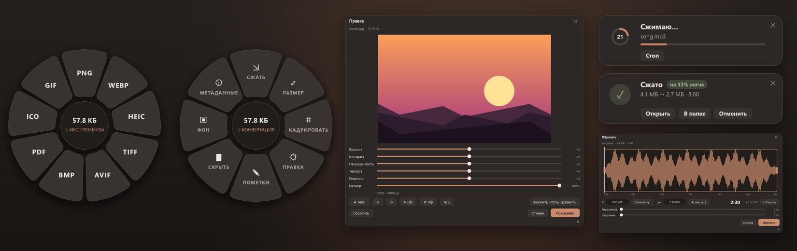
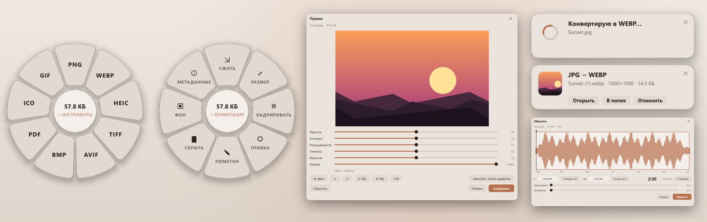
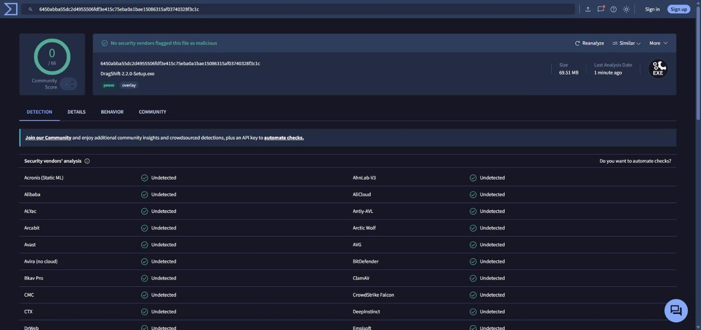
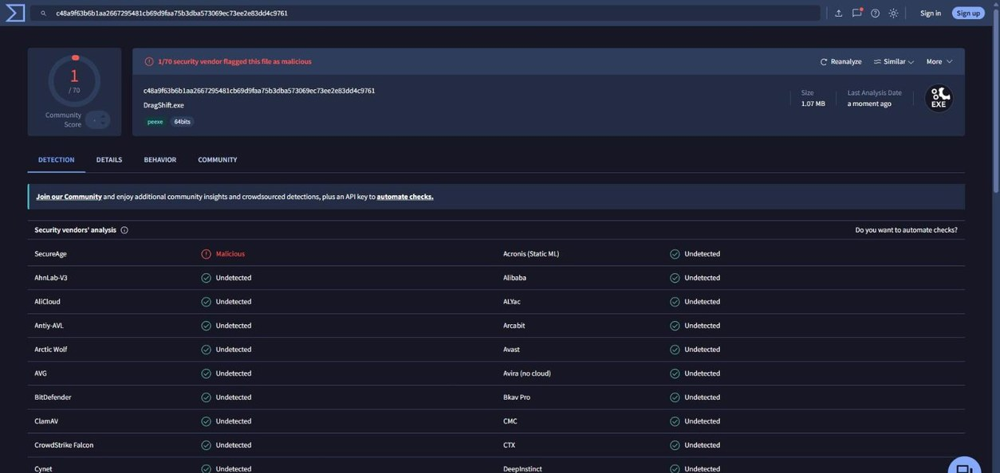
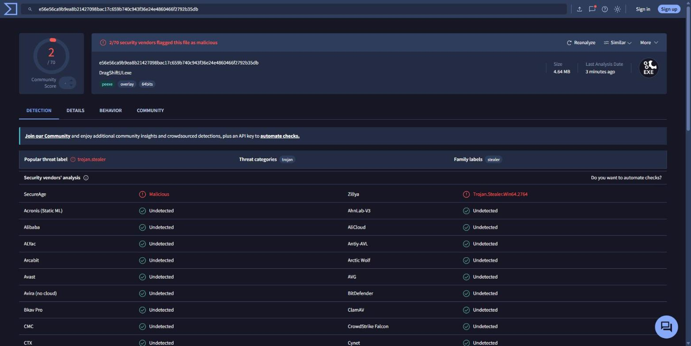
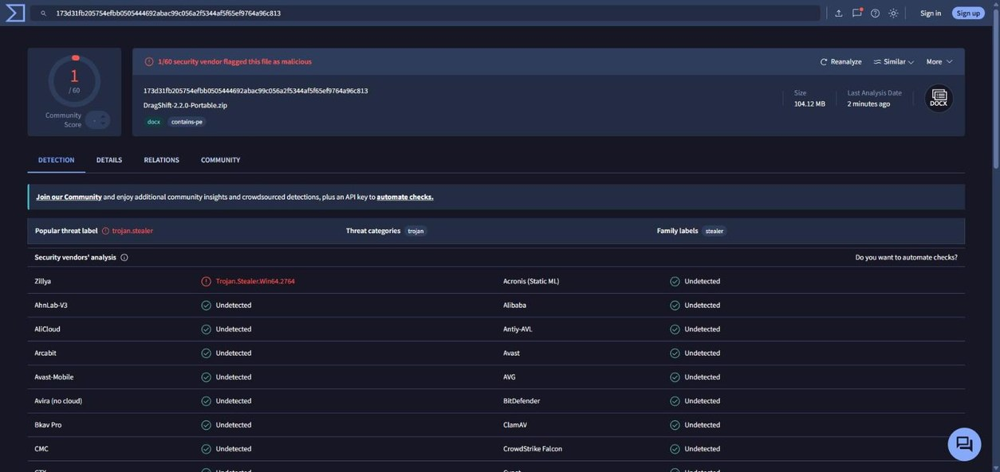

# DragShift

**Начните тащить любой файл, нажмите Shift и бросьте его на сектор меню.** Конвертация и правка картинок, PDF, документов, **аудио и видео** прямо из Проводника, без открытия программ.

[English below](#english)





## Скачать

В [последнем релизе](../../releases/latest):

- **DragShift-2.1.0-Setup.exe** (рекомендую). Ставится только для вашего пользователя, админ не нужен. Добавляет пункт в Пуск, автозапуск (по желанию), пункт **DragShift…** в контекстное меню и **Отправить → DragShift**. Удаляется начисто через Параметры → Приложения.
- **DragShift-2.1.0-Portable.zip**. Распаковал и запустил `DragShift.exe`, ничего не ставится.

Windows 10 и 11, 64 бита. ffmpeg уже внутри, ничего доустанавливать не надо.

> SmartScreen может ругнуться, потому что exe не подписан платным сертификатом. Жмите **Подробнее → Выполнить в любом случае**. Хеши файлов лежат в `SHA256SUMS.txt` рядом с релизом, результаты VirusTotal ниже.

## Протестить за 2 минуты

1. Поставьте DragShift-Setup.exe и оставьте галку «Запустить». Справа внизу появится карточка «DragShift готов», а в трее иконка.
2. Возьмите любой **mp3/wav/flac**, начните тащить мышкой и, не отпуская, нажмите **Shift**. Под курсором откроется меню.
3. Бросьте файл на **MP3**, **OPUS** или **FLAC**. Готовый файл появится рядом с оригиналом, оригинал не трогается.
4. Каждое нажатие Shift во время перетаскивания переключает кольцо: **Конвертация → Инструменты → Сжатие**.
5. Видео (**mp4/mkv/mov…**): кольцо **Сжатие** ужмёт ролик до 10, 25 или 50 МБ для Discord и мессенджеров. На видеокартах NVIDIA, Intel и AMD это в разы быстрее.
6. **Инструменты → Обрезать** открывает окно с волной и раскадровкой: тащите края, слушайте пробелом, ставьте затухания.
7. Без перетаскивания: правый клик по файлу → **DragShift…**, **Отправить → DragShift**, или иконка в трее → **Открыть файл…**.
8. Сделайте скриншот через **Win+Shift+S**, кликните иконку в трее → **Сохранить скриншот в «Изображения»** и выберите формат. Файл сразу ляжет в `Изображения\Screenshots`.

## Что умеет

| Файлы | Конвертация | Инструменты |
|---|---|---|
| **Аудио** mp3, m4a, aac, wav, flac, ogg, opus, aiff, wma, alac, amr, ape… | MP3, M4A, WAV, FLAC, OGG, OPUS, AIFF, WMA, ALAC | Обрезка с волной, нарастание и затухание, прослушка. Битрейт 320…64k. Скорость с сохранением тона |
| **Видео** mp4, mkv, mov, webm, avi, wmv, flv, ts, 3gp… | MP4, MKV, WEBM, MOV, AVI, GIF, MP3, M4A, WAV | Сжать до 10/25/50 МБ или в 2 и 4 раза (GPU: NVENC, Quick Sync, AMF), обрезка, кадрирование, поворот без перекодирования, скорость, убрать звук, вытащить звук, стоп-кадр в PNG |
| **Картинки** png, jpg, webp, heic, avif, tiff, bmp, gif, ico | PNG, JPG, WEBP, HEIC, TIFF, AVIF, BMP, PDF, ICO, GIF | Сжатие, размер, кадрирование, правка света и цвета, пометки, скрытие личного, фон, метаданные и GPS |
| **PDF** | JPG, PNG, DOCX, TXT | Сжатие, разделение, поворот, объединение, пароль, достать картинки, метаданные |
| **DOCX, TXT, MD, CSV…** | PDF, TXT, DOCX | |
| **Excel, PowerPoint** xlsx, xlsm, xls, pptx, ppt | PDF | Если стоит Microsoft Office или LibreOffice, конвертирует через них. Без них DragShift сам рисует таблицы и слайды: текст, картинки, заливки, таблицы, шрифты презентации |

Когда это возможно, DragShift вообще не перекодирует: смена контейнера, поворот MP4/MOV и быстрая обрезка копируют потоки как есть и делаются за доли секунды. Обложки альбомов и теги сохраняются. Битрейт выше исходного DragShift делать откажется, потому что файл только раздуется. А если ролик и так меньше 10 МБ, он просто скажет об этом и ничего не создаст.

**Скриншоты из буфера.** Сделали скрин через Win+Shift+S или Print Screen, кликните иконку в трее. Там два пункта: **Сохранить скриншот в «Изображения»** (сразу в `Изображения\Screenshots`) и **Сохранить скриншот в папку…** (спросит папку и запомнит её). Форматы любые: PNG, JPG, WEBP, HEIC, TIFF, AVIF, BMP, PDF, ICO, GIF. Скопированные в Проводнике картинки тоже сохраняются. Когда в буфере нет картинки, пункты серые.

**Вид.** Матовое меню и окна в цветах эспрессо с терракотовым акцентом. Светлая и тёмная тема переключаются вместе с Windows, а в Настройках → Тема можно закрепить любую. Анимации идут с частотой вашего монитора (60, 144, 240 Гц).

**Язык** берётся из Windows: русский, украинский или английский. Поменять можно в Настройках.

## Сколько ест ресурсов

Замерено на сборке из этой ветки: Intel Core i7-8700 (12 потоков), 32 ГБ, GTX 1060, монитор 240 Гц, Windows 11. «Память» тут это рабочий набор, его же показывает Диспетчер задач. Private это сколько процесс реально занял у системы.

| Что происходит | Процессор | Память (рабочий набор / private) |
|---|---|---|
| DragShift висит в трее, 2 минуты обычной работы за ПК | **0.01%** всего CPU (0.14% одного ядра, это хук мыши) | **0.6…1.8 МБ** / 2.1…2.7 МБ, 3 потока |
| Меню открыто | **0.76%** всего CPU (9% одного ядра), **240 кадров/с**, кадр рисуется за 0.47 мс | 10.9 МБ / 6.1 МБ, после закрытия снова 0.6 МБ |
| Открыт редактор картинки (процесс DragShiftUI.exe) | 0% в простое, процесс стартует за 0.5 с | 87 МБ / 71 МБ |
| Плюс окно обрезки аудио (mp3 на 3 минуты) | 0% в простое | 98 МБ / 78 МБ на весь процесс |
| Окна закрыты | DragShiftUI.exe сам завершается через минуту | 0 |

На диске: установленный DragShift занимает **270 МБ** (сам демон 1 МБ, окна редактора 174 МБ, ffmpeg 95 МБ). Установщик **69.5 МБ**, портативный zip **104 МБ**.

Как это устроено: то, что работает всегда (хуки клавиатуры и мыши, меню, уведомления, ffmpeg), это маленькая нативная программа на Rust. Никаких таймеров и опросов в простое, только системные хуки. Окна редактора (PySide6) запускаются, только когда вы их открываете. ffmpeg работает с пониженным приоритетом, так что даже сжатие 4K не мешает играм. Пример: ролик 1080p60 на 40 секунд, 172 МБ → 9.2 МБ за 3.8 секунды на GTX 1060.

## Проверка на вирусы

Каждый файл сборки залит на VirusTotal:

| Файл | SHA-256 | VirusTotal |
|---|---|---|
| DragShift-2.1.0-Setup.exe | `b473c351223a37444704eb16c42b6ca6a9500fb3195ad4158db2a437e422a5ce` | [0/66](https://www.virustotal.com/gui/file/b473c351223a37444704eb16c42b6ca6a9500fb3195ad4158db2a437e422a5ce) |
| DragShift-2.1.0-Portable.zip | `7047a4e6262199d064ca7c1d8727260596af1b484c4f07639dfddb5fb9fdffd8` | [1/65](https://www.virustotal.com/gui/file/7047a4e6262199d064ca7c1d8727260596af1b484c4f07639dfddb5fb9fdffd8) |
| DragShift.exe (демон) | `7c37aa12312e4bd8af44c8b167536e97e7c29e1428225af83829a04915c6cbcb` | [1/70](https://www.virustotal.com/gui/file/7c37aa12312e4bd8af44c8b167536e97e7c29e1428225af83829a04915c6cbcb) |
| ui\DragShiftUI.exe (окна редактора) | `7d149546d5ca2c0aaed7afb3af63fc4284c0e8245e9ee1c52186ece7b654ef64` | [2/71](https://www.virustotal.com/gui/file/7d149546d5ca2c0aaed7afb3af63fc4284c0e8245e9ee1c52186ece7b654ef64) |
| ffmpeg\ffmpeg.exe 8.0.1 | `5af82a0d4fe2b9eae211b967332ea97edfc51c6b328ca35b827e73eac560dc0d` | [0/69](https://www.virustotal.com/gui/file/5af82a0d4fe2b9eae211b967332ea97edfc51c6b328ca35b827e73eac560dc0d) |









Установщик чистый. Срабатывания у бинарей ложные, и вот почему. **SecureAge** помечает «Malicious» почти любой свежий exe без платной цифровой подписи. **Zillya** называет `Trojan.Stealer` стандартный загрузчик PyInstaller, которым упакованы окна редактора; она же находит его внутри zip. Microsoft Defender, Kaspersky, ESET, Bitdefender, Avast, DrWeb, CrowdStrike и остальные 60+ движков ничего не видят. Код открыт, сборку можно повторить командой из раздела ниже и сравнить хеши.

## Безопасность

- Оригиналы никогда не меняются, результат всегда пишется новым файлом, во время работы во временный `.part`.
- В комплекте ffmpeg 8.0.1 «essentials» от [gyan.dev](https://www.gyan.dev/ffmpeg/builds/). Сборка скачивает строго этот архив и проверяет SHA-256 архива и `ffmpeg.exe` до использования.
- Никакой сети, телеметрии и рекламы. Весь код открыт.

## Сборка из исходников

Нужны Rust (stable), Python 3.10+ и Inno Setup 6.

```bash
python -m venv .venv
.venv\Scripts\pip install -r requirements.txt pyinstaller
powershell -ExecutionPolicy Bypass -File packaging\build.ps1 -Python .venv\Scripts\python.exe
```

Результат в `dist\`. Для разработки хватит `cargo build --release` в `native\`: собранный `DragShift.exe` сам найдёт `.venv` и запустит окна из исходников. Проверки: `DragShift.exe --selftest` (33 сценария аудио и видео) и `pytest`.

Устройство: `native/` демон на Rust (меню, хуки, трей, уведомления, ffmpeg, задачи), `dragshift/` окна редактора и работа с картинками и PDF. Они общаются JSON-строками через stdin/stdout.

## Благодарности

Оригинальный DragShift сделал [llamaboi55](https://github.com/llamaboi55/DragShift): радиальное меню, редакторы картинок и PDF. Этот форк добавил аудио и видео, нативный демон, матовый дизайн, русский и украинский языки и новую сборку. Версии для Mac и Linux живут в оригинальном репозитории, код Python-приложения 1.x здесь сохранён (`dragshift/app.py`), но в этом форке они не собираются и не проверяются.

Лицензия MIT. ffmpeg распространяется под GPL v3 отдельной программой, его лицензия лежит в `ffmpeg\`.

---

<a name="english"></a>
## English

**Start dragging any file, press Shift, drop it on a slice of the menu.** Convert and edit images, PDFs, documents, **audio and video** right from File Explorer.

**Download** from the [latest release](../../releases/latest): `DragShift-2.1.0-Setup.exe` (per-user, no admin, adds a right-click **DragShift…** entry and Send To) or `DragShift-2.1.0-Portable.zip`. Windows 10/11 x64, ffmpeg included.

**Try it:** install, drag an mp3 or a video, press Shift while dragging, drop it on MP3, OPUS or **25 MB**. Each Shift press while dragging switches the ring (Convert, Tools, Compress). **Tools → Trim** opens a waveform editor with fades and preview playback.

**New in 2.1**
- Excel and PowerPoint (xlsx, xlsm, xls, pptx, ppt) to PDF. Microsoft Office or LibreOffice does it when installed; without them DragShift draws the sheets and slides itself, with the presentation's own fonts.
- Save a screenshot from the clipboard (Win+Shift+S, Print Screen, copied pictures) in any image format from the tray icon: straight to `Pictures\Screenshots`, or to a folder you pick (remembered for next time).
- PDFs made from documents use real installed fonts (Cyrillic italics look right, copied text keeps its spaces), and Word documents convert through Word when it is installed.

**What's in 2.0**
- Audio: MP3, M4A, WAV, FLAC, OGG, OPUS, AIFF, WMA, ALAC; bitrate presets; trim with waveform, fades and listening; speed with pitch kept.
- Video: MP4, MKV, WEBM, MOV, AVI, GIF; compress to 10/25/50 MB or ½ / ¼ with GPU encoders (NVENC, Quick Sync, AMF) and a CPU fallback; trim (exact or keyframe-fast), crop, lossless rotate, speed, mute, extract soundtrack, frame snapshot.
- A matte espresso-and-terracotta look, light or dark with Windows (or pinned in Settings → Theme), animated at your monitor's refresh rate.
- English, Russian and Ukrainian UI, following Windows or set in Settings.
- Streams are copied instead of re-encoded whenever possible; cover art and tags are kept; originals are never modified. DragShift won't raise a bitrate or "compress" a file that is already under the target size, it just tells you so.

**Measured resource use** (i7-8700, 12 threads, 32 GB, GTX 1060, 240 Hz monitor, Windows 11; memory is the working set Task Manager shows, then private bytes):

| State | CPU | Memory |
|---|---|---|
| Idle in the tray, 2 minutes of normal PC use | 0.01% of total CPU (0.14% of one core, the mouse hook) | 0.6–1.8 MB / 2.1–2.7 MB |
| Menu open | 0.76% of total CPU, 240 fps, 0.47 ms per frame | 10.9 MB / 6.1 MB, back to 0.6 MB once closed |
| Image editor open (DragShiftUI.exe) | 0% idle, process starts in 0.5 s | 87 MB / 71 MB |
| Plus the audio trimmer (3 min mp3) | 0% idle | 98 MB / 78 MB for the whole process |
| Editors closed | DragShiftUI.exe exits after a minute | 0 |

On disk: 270 MB installed (daemon 1 MB, editor windows 174 MB, ffmpeg 95 MB); the installer is 69.5 MB, the portable zip 104 MB.

**VirusTotal (2.1.0):** Setup.exe 0/66, Portable.zip 1/65, DragShift.exe 1/70, DragShiftUI.exe 2/71, ffmpeg.exe 0/69. Links and SHA-256 are in the table above. Setup is clean; the hits on the binaries are false positives: SecureAge flags almost any new unsigned exe, and Zillya calls the stock PyInstaller bootloader of the editor windows `Trojan.Stealer` (and finds it again inside the zip). Defender, Kaspersky, ESET, Bitdefender and 60+ other engines report nothing.

**Build:** Rust stable, Python 3.10+, Inno Setup 6, then `packaging\build.ps1` (see above). `DragShift.exe --selftest` runs 33 audio/video scenarios.

Based on [llamaboi55/DragShift](https://github.com/llamaboi55/DragShift). MIT license; the bundled ffmpeg (GPL v3) is a separate program with its license in `ffmpeg\`.
